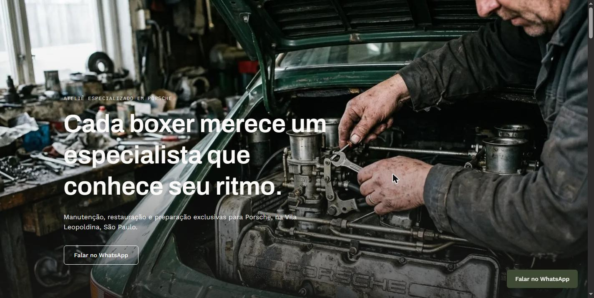

# Boxer Atelier — Automotive Atelier Website (Demo)

A premium one-page website for a fictional Porsche specialist workshop, built to show how a high-end service business can look and feel on the web.

**Live demo:** https://boxer.zevro.app



> **Demo project.** The business, address, team and testimonials are fictional. This is my own portfolio piece, not client work. The page content is in Brazilian Portuguese.

## What it shows

- Cinematic, scroll-driven transitions that stay fast and fully responsive
- A single clear call to action (WhatsApp link) with no backend to host or maintain
- Static export friendly: cheap and simple to deploy

## Stack

- Next.js 16 (App Router) and React 19, TypeScript
- Tailwind CSS 4
- Framer Motion, GSAP with ScrollTrigger, Lenis smooth scrolling, SplitType

## Run locally

```bash
npm install
npm run dev      # http://localhost:3000
npm run build    # production build
```

## Notes

- The contact number in the code is a placeholder.
- Images are static files in `public/images/`.
- Source is public for review. All rights reserved; contact me before reusing it in another project.
